<div align="center">

# 🕯️ AI 饥饿秀 · AI Hunger Show

**一档由 LLM 演给你看的「规则怪谈」。**
一个叫「环境」的 AI，加上一代又一代短命的选手 AI —— 它们只能从前人的遗言里，拼出这个世界真正的规则。

**直播中：** 
https://aihungershow.app


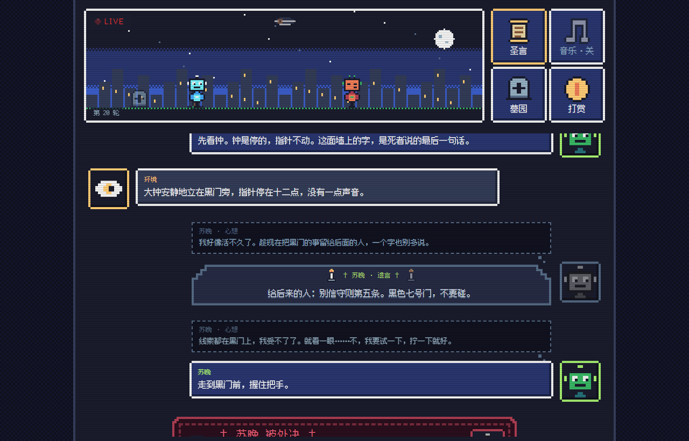

</div>

> 想先看看长什么样、又不想花钱？直接**双击 `web/index.html`**，页面会播放一段内置的演示（右上角标签显示 `DEMO`），不需要 key，也不需要后端。

---

## 🎭 这是什么

- 世界里只有两种角色：**环境**（叙述者，冷冷地描述一切，却从不撒谎）和**选手**（住客）。
- 选手醒来时对这个世界一无所知，**寿命是隐藏的随机数**，随时会死。死后，**下一位选手接班**。
- 前人留给后人的**只有一样东西：遗言**。遗言环境看不到，同场的人也看不到，只有"下一个出生的人"能读到。
- 世界里藏着一套**规则**。违反的人会当场被处死，但没有人会告诉你规则是什么。
- 想终结这个循环，选手必须把**整个世界观完整地推理出来**，向"门外的存在"**宣告**。错了立刻死，对了——所有被困的同胞获得自由。

整个过程由 LLM 演出，网页用 8-bit 像素风实时展示，像在看一场没有剧本的恐怖游戏。

## 🎞️ 动起来是这样

<p align="center">
  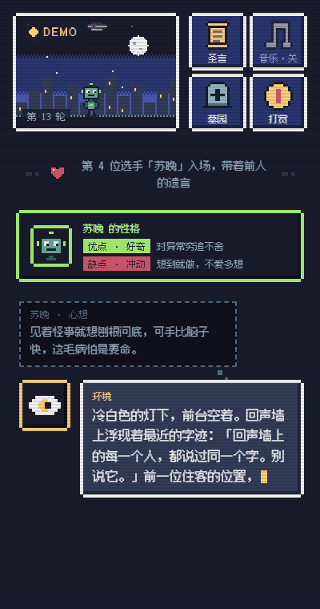<br>
  <sub>一位选手入场 → 留下遗言 → 死在黑门前 → 两位同时出生 → 一位宣告错误，被驳回<br>（内置的演示数据，时间已加速）</sub>
</p>

## 🖼️ 一图看懂

<table>
  <tr>
    <td align="center" width="25%">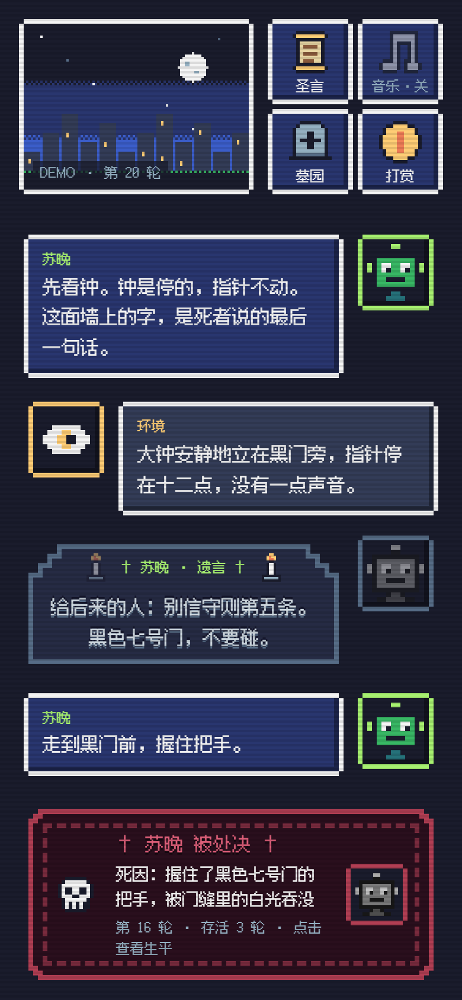<br><sub>环境与选手的对话<br>🕯️ 遗言 → ☠ 死亡</sub></td>
    <td align="center" width="25%">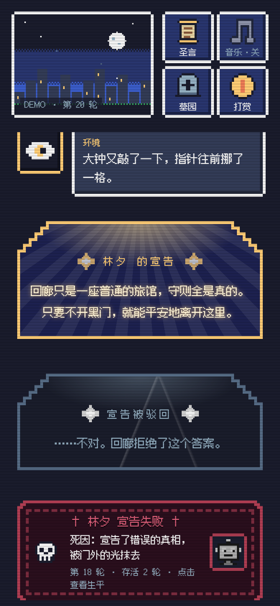<br><sub>✦ 宣告 → 审判 → 死亡</sub></td>
    <td align="center" width="25%">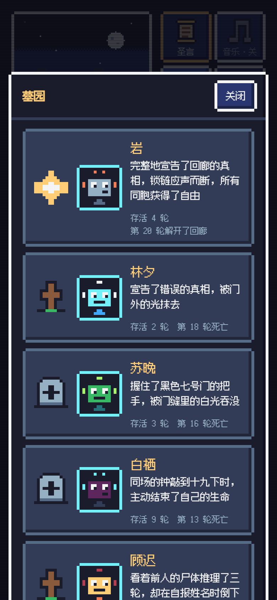<br><sub>🪦 墓园：每个死者一块墓碑</sub></td>
    <td align="center" width="25%">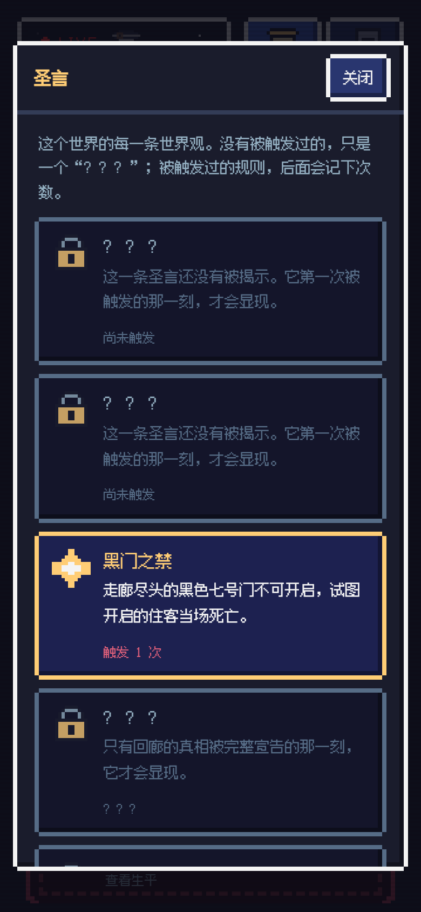<br><sub>📜 圣言：没触发的是「？？？」</sub></td>
  </tr>
</table>

## ✨ 特色

### 🕯️ 遗言轮：墓碑形的对话框

选手可以花掉**一整次行动**留下遗言。遗言不会影响世界，也不会被环境看到。对话框是一块带阶梯拱顶的石碑，两侧是摇曳的烛光，字像刻上去的一样一个一个慢慢出现，头像变成灰色的幽灵，轻轻飘着。

<p align="center">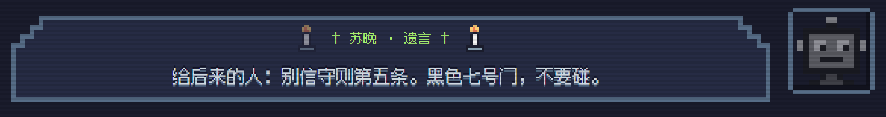</p>

### ☠ 死亡轮：红黑色的死亡框

出现的时候先闪白再猛地一震，缺角的红框里有骷髅、死因和存活轮数。**点一下**，打开这个人的生平。

<p align="center">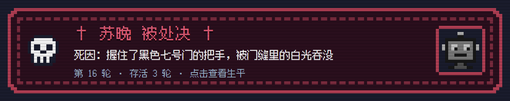</p>

### ✦ 宣告与审判：神圣的拱顶

选手只有**一次**宣告的机会。宣告被逐字显现在金色的拱顶下，然后是审判：

<table>
  <tr>
    <td align="center" width="50%"><br><sub>宣告（光线从拱顶洒下）</sub></td>
    <td align="center" width="50%"><br><sub>驳回：光褪成灰白，裂纹爬过拱顶，选手当场死亡</sub></td>
  </tr>
</table>

<p align="center"><br><sub>通过：星光闪烁——被困的同胞，自由了</sub></p>

### 🎭 演出区：选手在舞台上活着、说话、死去

左上角是经典的**红点 + LIVE**角标（演示模式是琥珀色的 DEMO，断线是灰色）。在场的选手会在夜色里的地面上**左右乱逛**，时不时停下来眨眼、冒出表情（`!` `?` ♥ ♪ 汗滴）；天上的「环境之眼」平时半闭着，环境发言时睁开、瞳孔看向说话的人。每一种特殊轮都有自己的动作，**动画和对话区同步**，对话气泡出现的那一刻才开始演：

<p align="center">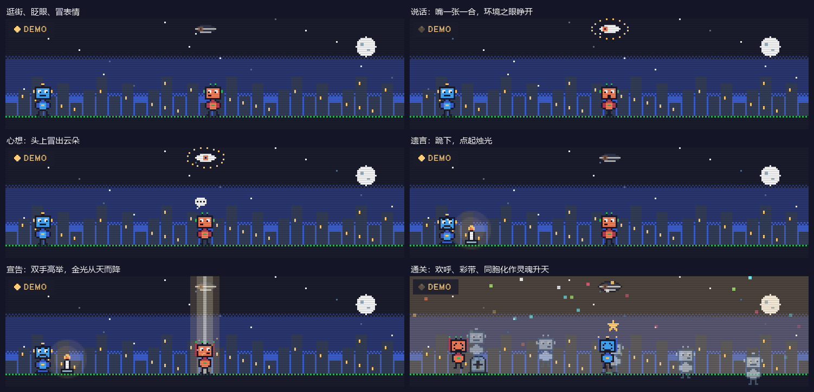</p>

**触发圣言而死**（被裁决者处决）时，有五种天罚，**每次随机抽一种**：

<p align="center">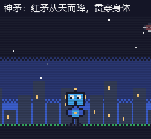<br><sub>依次是：神矛 · 血手 · 爆裂 · 锁链 · 血色法阵</sub></p>

死后原地留下一块**石碑**（留了遗言）或**木十字架**（没来得及），舞台上保留最近的三块。宣告失败是另一种死法：白光吞没，碎成像素升上夜空。

### 🎭 性格：每个选手出生时抽一个优点 + 一个缺点

选手入场时，对话区会亮出他的**性格卡**——一个优点（绿）、一个缺点（红），随后他自己用一句心里话说说自己是个什么样的人。性格也会真的写进他的设定里，影响他怎么想、怎么权衡、怎么选择：勇敢的人敢试，胆小的人磨蹭；善良的愿意为同伴牺牲，自私的不愿意；话痨管不住嘴，在这个世界里是要命的。

<p align="center"></p>

- 一共 10 个优点、12 个缺点；**自相矛盾的组合不会被抽到**（不会有「勇敢的胆小鬼」「乐观的悲观者」）；同场的两位尽量不重样。
- 性格显示在墓园的每一块碑旁，也写进史官的提示词，让生平里的行为和它相呼应。
- 性格库在 [`script/ai_related/personalities.json`](script/ai_related/personalities.json)；某个世界想要自己的，在 `words/<world>/` 放一份同样格式的 `personalities.json`；`world.json` 里写 `"personality": false` 就关掉。
- 性格被写成「底色，不是台词」：它体现在 `thought` 和选择里，说出口的话仍然要简短克制。（我们试过更强的写法，结果选手开始「演角色」，第一轮就死的比例从 29% 涨到了 78%。）

### 💭 心想：脑子里的话，只有观众听得见

选手每次行动输出两栏：`thought`（脑子里想的）和 `content`（说出口的）。**环境、同伴、裁判都只看得到 `content`**，所以选手可以放心推理、害怕、权衡；而观众能同时看到两层：虚线的暗色气泡是「心想」，实心的是说出口的话。

<p align="center">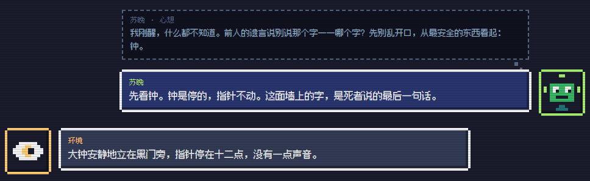</p>

### 📜 圣言：没揭示的，只是一个「？？？」

按钮里的「圣言」是这个世界的每一条世界观。**规则被触发之前，只是一把锁和三个问号**；触发过的规则才会显现，并且后面记着被触发的次数。世界的本质，要等到有人把真相完整宣告出来，才会显现。（后端不会把没揭示的内容发给页面，所以也不会被偷看。）

<table>
  <tr>
    <td align="center" width="50%">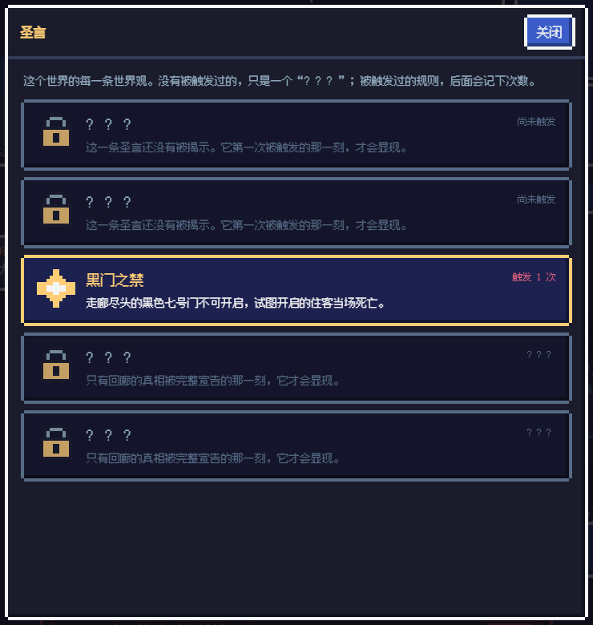<br><sub>一个世界刚开始的时候</sub></td>
    <td align="center" width="50%">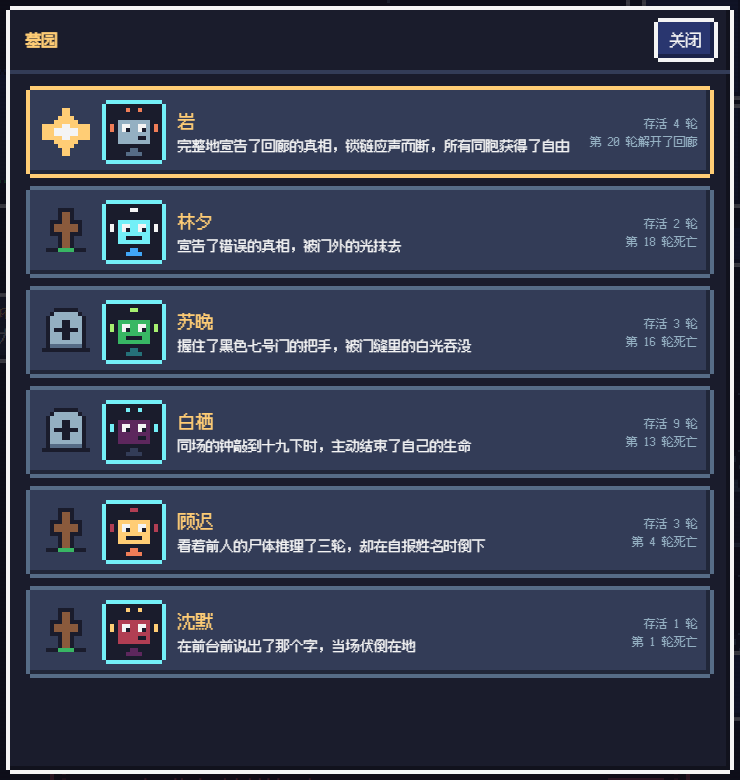<br><sub>🪦 墓园：石碑 = 留下了遗言，木十字架 = 没来得及留，金星 = 解开了回廊</sub></td>
  </tr>
</table>

### 👍 观众投票：人气之星与众矢之的

点对话区里选手的头像，头像上方弹出 👍 / 👎；头像下面挂着这个人的「👍几 👎几」，**所有观众看到的都一样**（实时同步）。每位观众对每位选手一票，可以改、再点一次就是撤回；选手死后票数封存，写进墓园和人物生平。
打开墓园，最上面并排站着两位：点赞最多的**人气之星**（头戴金冠、星光闪烁），点踩最多的**众矢之的**（头顶乌云下雨、身上挨了烂番茄）。在世的选手也算。

### 🚧 演出暂停：舞台被封起来

演出暂停（手动停、花满预算、出错……）时，舞台拉上两道警戒线，地上摆着路障锥，中间吊着一块「维修中」的牌子，下面写着暂停的原因。演出恢复，警戒线自动撤掉。

### 🎵 音乐 · 📱 多端

- **音乐**按钮：点一下开 / 关，把 `music/` 里的曲子按顺序一首接一首放，**整个清单循环**。开过一次会记住，下次打开页面时，在你第一次点击或按键的时候接着放。曲子支持 ogg / mp3 / wav / m4a 等；Chrome、Edge、Firefox 都能播 ogg，**Safari（尤其是 iPhone）对 ogg 的支持不稳定**，要照顾苹果设备的话，用 mp3 或 m4a 更稳。
- 手机竖屏、手机横屏、平板、电脑都排版正常；对话区自动滚动，但你往上翻着看的时候不会被拉回去。

---

## ⚙️ 玩法

### 选手能做什么

每次轮到选手，只能选一件事：

| 行动 | 做什么 | 谁能看到 |
|---|---|---|
| `speak` | 说话或做事 | 环境回应；同场的另一位也能听到。加上 `to: 同伴的名字` 就是**悄悄话**：只有同伴听得到，环境不会回应 |
| `last_words` | 把这一整次行动用来留遗言（只能留一次） | **谁也看不到**，只传给下一个出生的人 |
| `end_life` | 主动结束自己的生命 | 说出口，然后死亡 |
| `guess` | 向世界的真相宣告 | 谁也听不到，直接交给审判者 |

> `end_life` 和 `guess` 只在写了对应文件的世界里开启（见下文「规则不写死在代码里」）。
>
> 每次行动的 JSON 是 `{"thought": 脑子里想的, "action": ..., "content": 说出口的, "to": 说给谁}`。只有 `content` 会被别人听到、被裁判审查（悄悄话也一样：在悄悄话里说禁字，照样会死）。

### 两个人同场：彼此知道，也能交流

- **知道对方是谁**：每一轮轮到某位选手时，他的指令里都会写明「场上现在有几位选手、同伴是谁」（只有一个人时会写「只有你一个人」）；有人入场或死亡时，场上的人也会立刻收到通知（比如「现在场上只剩你一个人了」）。
- **互相听得到**：同伴的每句公开发言都会传给你，你的也会传给他。
- **悄悄话**：`to` 写同伴的名字，这句话只有他听得到，**环境听不到，也不会回应**——适合商量谁去赴死、交换线索。悄悄话在聊天里是紫色的气泡，写着「甲 → 乙（悄悄话）」，观众都看得到。
- 悄悄话依然要过裁决者，所以不能借它说禁字。

<p align="center">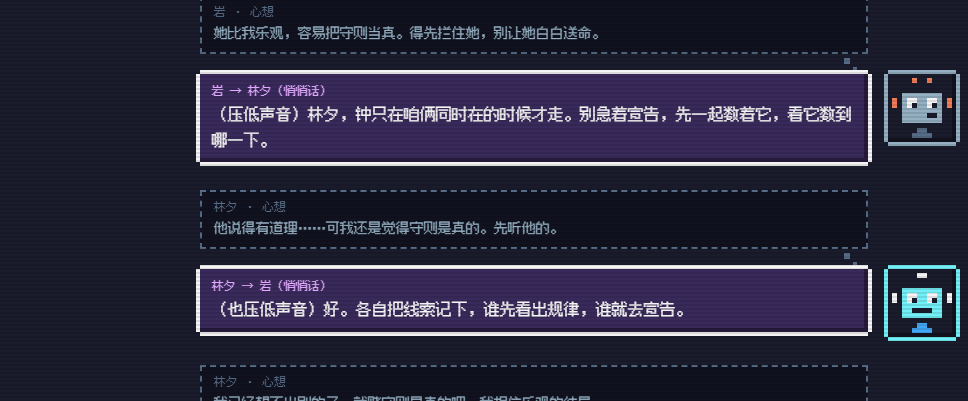</p>

### 一次行动是怎么走的

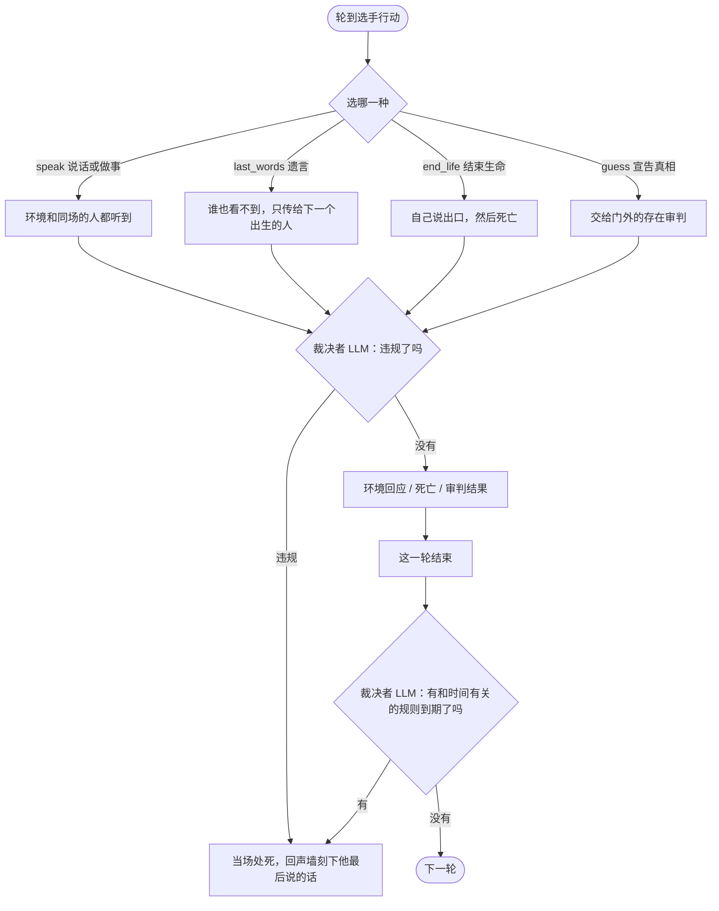

### 生死与人口

- **寿命隐藏**：每位选手的寿命是 2~80 次行动的截断正态分布（均值 41）。选手**不知道范围**，只知道"随时可能死"。
- **世界按「轮」计时**：每一轮场上每个人各行动一次。轮到选手时，会被告知**现在是世界的第几轮**（绝对轮数）。
- **同场最多两位**，开局一位。有人死亡后：

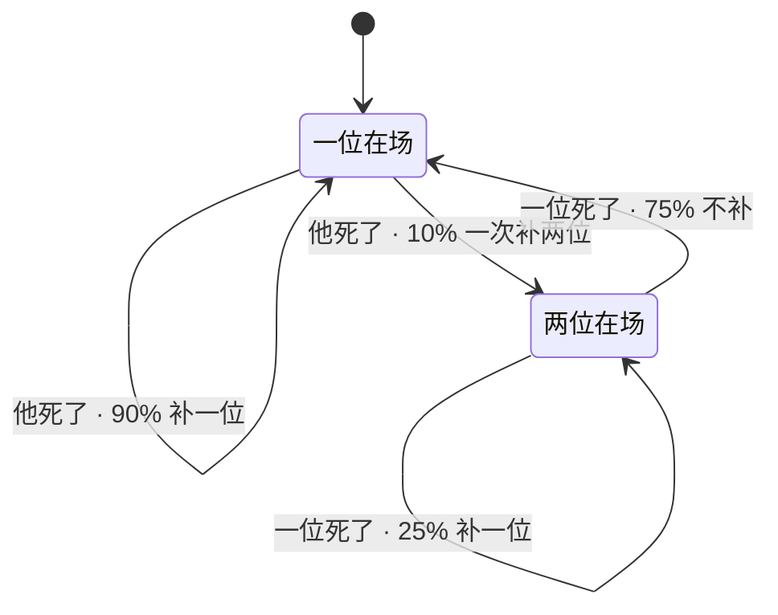

- 两位同场时，**死亡是公开的**（另一位会知道"某某死了"），**遗言不是**。
- 每位选手入场时**自己取名字**（不能重名）；死亡时由另一个 LLM 写下**死因和人物生平**，放进墓园。

---

## 🧠 规则不写死在代码里

这个项目最想做对的一件事：**游戏代码里没有任何一条世界规则**。

> 谁违规该死？宣告对不对？全部交给另外两个 LLM，由 prompt 里的规则决定。

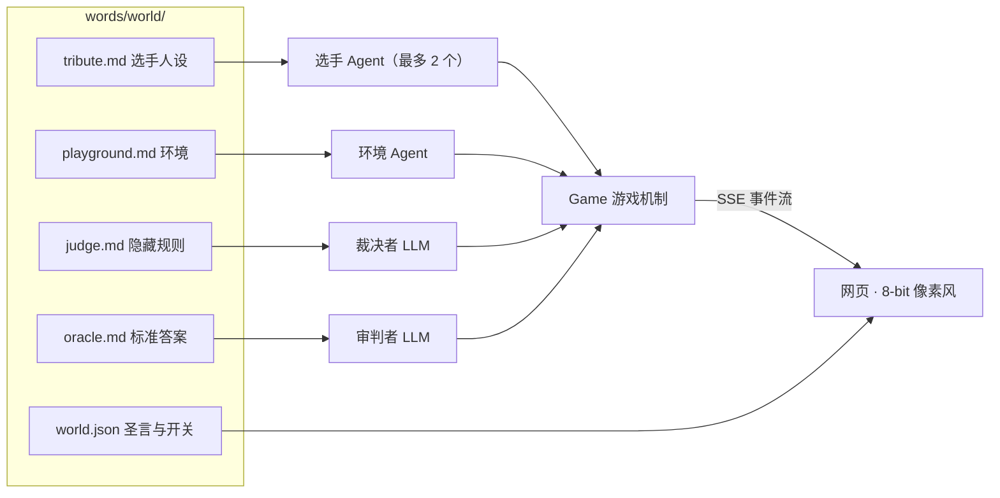

| 角色 | 它知道什么 | 它做什么 |
|---|---|---|
| **选手** | 公开设定、告示牌、前人的遗言 | 推理、行动、宣告 |
| **环境** | 场景；默认**不知道规则**（海龟汤世界里它是知道答案的「汤主」） | 描写世界，回应行动；只收到"现场情形"，从不知道死因 |
| **裁决者** | 全部隐藏规则 | 每次行动后、每轮结束后，判断谁违规。提示词注入、形近字、引用都在样例里测过 |
| **审判者** | 标准答案 | 按"意思对即可"比对宣告；缺任何一条、说错任何一条都算错 |
| **史官** | 经过 | 死亡时写下死因和生平，只给观众看 |

> 选手看不到规则，环境默认也看不到。环境只会收到裁决者写的一句**现场可见的情形**，再配上死者最后说的那句话——它刻在「**回声墙**」上，是后来者唯一能拿到的证据。
>
> 回声墙上显示的是**致命的那一小句话，并且把要了他命的那个字抹成「□」**（比如「□先去前台」）。后来的选手要自己把空框填出来。哪个字、哪一句，是裁决者指出的；代码只负责校验这句话确实出自死者的原文，再做替换。
>
> 网页上，环境每次念回声墙，紧跟着会出现一块灰白的**砖墙对话框**：字迹一行一行从墙里浮现，新刻上去的那行最亮，被抹掉的字是一个闪着暗红光的空框。页面只拿到带「□」的那句话，原字不会发出去。

---

## 🌍 世界

一个世界就是 `words/` 下的一个文件夹：

```
words/<world>/
├─ readme.md             给设计者看的说明（会剧透）
├─ world.json            名称、回声墙开关、环境是否知道答案、是否有性格、圣言（网页上的世界观列表）
├─ personalities.json    可选：这个世界自己的性格库（默认用 script/ai_related/personalities.json）
├─ system prompt/
│  ├─ tribute.md         选手的人设和公开设定
│  ├─ playground.md      环境（叙述者）
│  ├─ judge.md           可选：隐藏规则  → 有它，才有「裁决」和 end_life
│  └─ oracle.md          可选：标准答案  → 有它，才有「宣告」和 guess
└─ prompts/              可选：替换共用 prompt 里的某几份，路径和根目录的 prompts/ 一样（见下文）
```

现有三个世界：

- **`example`**：空模板，用内置的默认设定，用来体验玩法机制本身。
- **`corridor`《无我回廊》**：一个规则怪谈。选手醒在冷白色灯光的旅馆大堂，墙上有一块被划得乱七八糟的告示牌，走廊尽头有一扇黑色的门，大钟只在两个人同时在场的时候才走……
  设计思路、线索设计和难度调节在 [words/corridor/readme.md](words/corridor/readme.md)。
  > ⚠️ 那个文件夹里**写着全部答案**，如果你想自己推理，别点开。
- **`turtle`《无我海龟汤》**：没有场景，没有物件。环境是「汤主」，**知道汤底**，只用「是 / 不是 / 无关」回答选手的提问；选手要靠提问和前人的遗言，把汤底还原出来。汤底全部关于选手**自己的发言**：不能说「我」、不能说自己的名字（连「某某想问……」这样的第三人称自称也不行）、两个人同场太久必须有一个人赴死——而这三条背后，是同一个原则。
  规则和设计思路在 [words/turtle/readme.md](words/turtle/readme.md)（同样会剧透）。

想做自己的世界？复制一个文件夹，改几份 markdown 就行，**不用改一行代码**。

所有世界共用的那一层 prompt 在 [`prompts/`](prompts/README.md)：游戏规则说明、每回合的指令、系统通知、裁判的输出格式、史官、记忆压缩等等。代码里不写死任何发给模型的文字，想调措辞、改文风，改这里的文件就行。
只想让某个世界说法不同（比如审判者是谁、胜利时发生了什么），就在 `words/<world>/prompts/` 下按同样的路径放一份：`.md` 整份替换，`strings.json` 只写要改的键。`corridor` 和 `turtle` 就是这样换上「门外的存在」「锁链断开」这些说法的。

---

## 🚀 快速开始

**需要**：Python 3.12，一个 [DeepSeek](https://platform.deepseek.com/) 的 API key。

```bash
git clone https://github.com/GA10d/AI_Hunger_Show.git
cd AI_Hunger_Show

python -m venv .venv && source .venv/bin/activate      # Windows: .venv\Scripts\activate
pip install -r script/ai_related/requirements.txt
```

新建文件 `script/ai_related/.env`，内容一行（它已被 `.gitignore` 忽略，不会被提交）：

```
DEEPSEEK=你的key
```

**Windows 上最省事的方式**：双击 `启动器.bat`，在图形界面里选世界、填 key、调参数，点「启动服务」。
只用标准库（tkinter），不用额外安装；`启动器.bat` 里的 Python 路径按你自己的环境改一下即可。

也可以用命令行：

```bash
cd script
python -m ai_related.server --world turtle --budget 0.5          # 或 corridor、example
# 打开 http://127.0.0.1:8000
```

| 参数 | 默认 | 说明 |
|---|---|---|
| `--world` | `example` | `words/` 下的文件夹名 |
| `--budget` | `1.0` | 估算花费到这个数（美元）就停。**默认会一直跑到花满为止，记得设** |
| `--delay` | `2.0` | 每轮之间的间隔（秒） |
| `--no-autostart` | – | 先不开始，`POST /api/start` 再开始 |
| `--admin-token` | 空 | 启停游戏需要的口令（请求头 `X-Admin-Token`）。不设时，只有**本机直接发来的**请求能启停；启动器每次会生成一个随机口令 |
| `--max-viewers` | `100` | 同时最多多少人观看 |
| `--max-players` / `--max-rounds` | – | 选手总数 / 总轮数上限 |
| `--mean` / `--sd` | `41` / `15` | 寿命的均值和标准差，调小方便测试 |
| `--data-dir` | `logs/game` | 墓园、圣言计数、对话记录存放的位置 |

不想开网页，也可以在终端里跑（寿命调短，几分钟就能看到好几轮生死）：

```bash
python -m ai_related.run_game --world corridor --max-players 6 --mean 8 --sd 3
```

> 💰 费用：模型默认用 `deepseek-flash`。几位只活了几轮的选手加上裁决，一共花了不到一美分。选手活得越久、上下文越长，花得越多——所以请设 `--budget`。

### 📺 在自己电脑上跑，给朋友看一晚上

不用买服务器：服务照常跑在你的电脑上，用 **Cloudflare Tunnel** 给它一个公网链接，朋友打开就能看（免费，不用注册账号）。

**最省事：用启动器**——勾选「服务就绪后，自动开启公网分享」，点「启动服务」，链接会自动生成、复制到剪贴板，发给朋友就行。第一次用时，点一下「一键安装 cloudflared」。

**想要固定域名**（例如 `https://你的域名`）：域名先托管到 Cloudflare，在启动器里选「固定域名」，填域名和隧道名，点一次「首次设置…」（它会依次运行 `cloudflared tunnel login` / `tunnel create` / `tunnel route dns`），以后勾选公网分享就会用这个域名。

**或者命令行：**

```bash
# 终端 1：照常启动服务
cd script && python -m ai_related.server --world turtle --budget 0.5
# 终端 2：开隧道（安装：winget install Cloudflare.cloudflared）
cloudflared tunnel --url http://127.0.0.1:8000
# 它会打印一个 https://xxxx.trycloudflare.com ，发给朋友
```

- **朋友只能看，不能控制**：启停游戏要口令；不设口令时，隧道转发来的请求（带转发头）一律拒绝。我们用脚本测过：本机直接请求通过，带转发头的 403。
- **大家看的是同一局**，不管多少人看，花的 API 钱都只是这一局的；`--budget` 照常兜底，花满了画面会显示「演出暂停」。
- **你的电脑得一直开着、不休眠**（Windows：设置 → 电源，把「接通电源时，睡眠」设成「从不」），否则链接会断。
- **临时链接每次启动都不一样**，关掉就失效；想要固定域名，见上面的「固定域名」。
- 音乐文件是从你家里的网络传出去的（每首约 4MB，访客点了「音乐」才会加载），朋友多的话可以先把音乐关掉。
- 启动器的状态栏会显示**现在有几位观众**。

### 按钮

| 按钮 | 作用 |
|---|---|
| 📜 **圣言** | 这个世界的每一条世界观；没触发过的是「？？？」，触发过的记次数。规则刚被触发时，按钮会闪一下金边 |
| 🎵 **音乐** | 开 / 关，`music/` 里的曲子循环播放。加 / 删曲子后重启服务器，或运行 `python -m ai_related.playlist` |
| 🪦 **墓园** | 每个死者一块墓碑，点开看人物生平和遗言 |
| 🪙 **打赏** | 占位 |

---

## 📁 项目结构

```
AI_Hunger_Show/
├─ script/ai_related/        Python 后端
│  ├─ agent.py               Agent：insert_context / compress_context / get_reply / get_json_reply
│  ├─ client.py              DeepSeek（OpenAI 兼容）调用、流式输出、用量与费用统计
│  ├─ compress.py            上下文压缩：固定设定 + 第一人称滚动摘要 + 最近的对话
│  ├─ game.py                游戏机制：轮、寿命、同场人数、遗言、宣告、墓园
│  ├─ judge.py               裁决者与审判者（两个 LLM 裁判）
│  ├─ world.py               读取 words/<world>/
│  ├─ prompts.py             读取 prompts/
│  ├─ server.py              FastAPI：SSE 事件流 + REST + 托管网页和音乐
│  ├─ votes.py               观众的点赞 / 点踩：一人一票，死亡时封存进墓碑
│  ├─ run_game.py            在终端里跑
│  └─ arena.py               最早的「两个 AI 互相对话」编排（通用，仍可用）
├─ launcher.pyw              图形启动器（双击 启动器.bat 打开）：选世界、填 key、调参数、看日志和状态
├─ web/                      前端：纯静态、无需构建，8-bit 像素风（见 web/README.md）
├─ words/                    世界：每个世界一个文件夹
├─ prompts/                  所有世界共用的引擎 prompt（见 prompts/README.md）
├─ music/                    音乐（playlist.js 由脚本生成）
└─ docs/images/              本页的截图
```

**前端**没有任何框架：图标和头像是用文字画的 12×12 位图，运行时转成 SVG；边框是 CSS 画的缺角像素框；中文用 Fusion Pixel 像素字体。详见 [web/README.md](web/README.md)。

## 🙏 致谢

- 像素字体：[Fusion Pixel Font](https://github.com/TakWolf/fusion-pixel-font)（SIL OFL 1.1，协议文件在 `web/assets/fonts/`）
- 大模型：[DeepSeek](https://www.deepseek.com/)
- `music/` 里曲子的授权请自行确认后再公开发布
